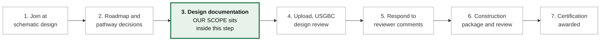
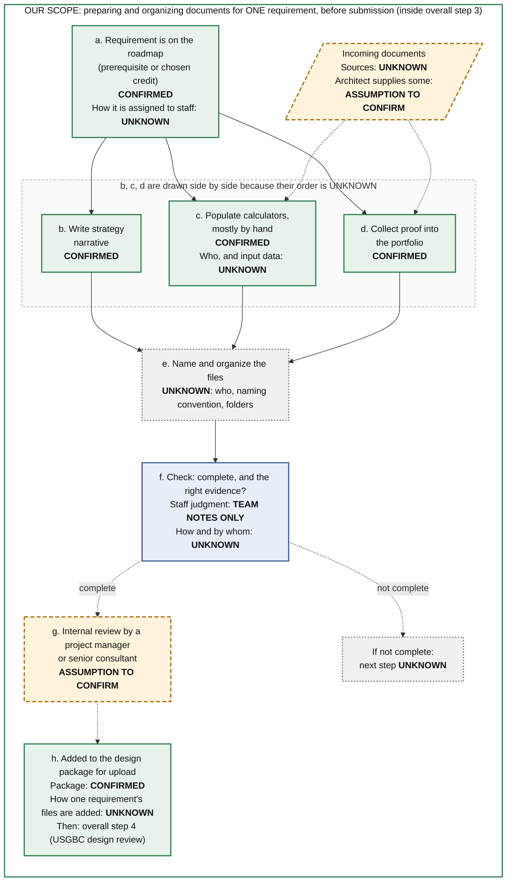

# Current Workflow — Step 2: Steps in Order (v2, revised)

**Revised:** 2026-10-13, after peer-team feedback. **Previous version:** [step2-v1-original.md](step2-v1-original.md) (preserved unchanged).

**Scope:** how ecoPreserve prepares and organizes the documents for **one LEED certification requirement** on a project, before submission. This describes the process as it works today. It does not propose changes.

**Source key**
- **[Repo]**: `partner-brief/class-visit-transcript.md` (Oscar, September 10, 2026 class visit) and the partner-brief summaries drawn from it.
- **[Team notes]**: our team's working notes. No partner-meeting notes are in the repo yet.

**Status labels**

| Label | Meaning | In the diagram |
|---|---|---|
| **CONFIRMED** | Stated in the Repo | Green box, solid border |
| **TEAM NOTES ONLY** | In our notes, not found in the Repo | Blue box, solid border |
| **ASSUMPTION TO CONFIRM** | Our guess, not yet checked with ecoPreserve | Amber box, dashed border |
| **UNKNOWN** | No information yet | Grey box, dotted border |
| Dashed arrow | The link between two steps is not confirmed | |

Every box also states its status in words, so the diagram still reads in black and white.

---

## Background: the overall certification process (brief)

ecoPreserve gets involved once the client starts schematic design, then works through design documentation, USGBC design review, construction review, and certification. **[Repo]** Our workflow is one small piece of **step 3, design documentation**.

*Note:* our notes say "early design stage." Oscar said ecoPreserve helps clients "from the very beginning where they're in conceptual design," but gets involved once schematic design starts. **[Repo]**

---

## Step 2 focus: one requirement, before submission

| Step | What happens | Status | Source |
|---|---|---|---|
| a | The requirement is on the project roadmap, as a prerequisite or a chosen credit | **CONFIRMED**. How it is assigned to a staff member: **UNKNOWN** | Repo |
| Input | Documents come in from outside ecoPreserve | Sources: **UNKNOWN**. Architect supplies some: **ASSUMPTION TO CONFIRM** (Oscar described working with the architect on the Orange County Convention Center) | Repo (architect example) |
| b | The strategy narrative is written | **CONFIRMED** | Repo |
| c | Calculators are populated, mostly by hand | **CONFIRMED**. Who populates them, and where the input data comes from: **UNKNOWN** | Repo |
| d | Proof documents are collected into the portfolio | **CONFIRMED** | Repo |
| e | Files are named and organized | **UNKNOWN**: who does it, naming convention, folder structure | None |
| f | Documents are checked: are they complete, and do they provide the right evidence? | That this takes staff judgment: **TEAM NOTES ONLY**. How and by whom: **UNKNOWN**. What happens if documents are incomplete: **UNKNOWN** | Team notes |
| g | Internal review by a project manager or senior consultant | **ASSUMPTION TO CONFIRM**. The title "project manager" does not appear in the Repo | Team notes |
| h | The requirement's documents go into the design package for upload, followed by USGBC design review (overall step 4) | Package: **CONFIRMED**. How one requirement's files are added: **UNKNOWN** | Repo |

**How to read the diagram**
- **Steps b, c, and d are drawn side by side because their order is UNKNOWN.** That doesn't mean they're confirmed to happen in parallel. Oscar described narratives before proof, but only at the project level. **[Repo]**
- **The "not complete" path ends at UNKNOWN.** We don't know what staff do when documents are missing, so the diagram doesn't draw a loop back.
- **Steps e and f are the core of our workflow, and they are the least documented.**

---

## Revision log

### v2 (2026-10-13), in response to peer-team feedback

**Feedback received:** "Wasn't represented by a clear diagram of the workflow."

**1. What the other team misunderstood**

- **No specific misunderstanding was recorded.** The feedback as we received it is about format (no diagram), not a point of content the other team got wrong. If their explain-back misstated something specific, add it here.
- **Our own assessment** (our interpretation, not the other team's feedback) is that v1 was hard to follow for four reasons:
  - It put two levels of process back to back: a 7-step project process and an a–h requirement process, both as ordered lists.
  - The fact that a–h sits inside project step 3 was stated only in a table heading.
  - Status labels were mixed into table text, so confirmed and unconfirmed steps looked alike when skimmed.
  - In a numbered list, unconfirmed links (f to g to h) looked as definite as confirmed ones.

**2. What we changed**

- Added a workflow diagram. It is embedded in this document as Mermaid (renders on GitHub) and also included as `step2-diagram.png` for slides and documents.
- Cut the overall certification process to a short background strip, with step 3 highlighted as the place our scope sits.
- Made the one-requirement steps (a–h) the main content.
- Shown each step's status in two ways: by color and border style, and in words inside every box.
- Drawn unconfirmed links as dashed arrows.
- Drawn steps b, c, and d side by side, with an explicit note that their order is UNKNOWN.
- Ended the "not complete" path at UNKNOWN, rather than drawing a rework loop we can't confirm.
- Shown incoming documents as a separate input, so their unknown sources and the architect assumption stand out.
- Added a source column to the step table.
- **Added no new facts.** Every statement traces back to v1, which traces to the Repo or our Team notes. The one wording change is that step h now names "overall step 4 (USGBC design review)" as what follows.

**3. What still needs confirmation from ecoPreserve**

| Diagram box | What to confirm | Status |
|---|---|---|
| g | Whether an internal review happens before upload, and who does it (title and role) | ASSUMPTION TO CONFIRM |
| Input | Which documents come from the client, the architect, the larger partner firm, or ecoPreserve | UNKNOWN / ASSUMPTION TO CONFIRM |
| a | How a requirement is assigned to a staff member | UNKNOWN |
| b–d | Whether narrative, calculators, and proof are done in order or at the same time | UNKNOWN |
| c | Who populates the calculators, and where the input data comes from | UNKNOWN |
| e | Who gathers, names, and organizes files; where they are stored; what formats; whether naming and folders differ across staff | UNKNOWN |
| f | How staff decide documents are complete and sufficient; who makes that call | UNKNOWN (that judgment is involved: TEAM NOTES ONLY) |
| f, not complete | What happens when documents are missing or insufficient | UNKNOWN |
| h | How one requirement's files are added to the package, and who uploads it | UNKNOWN |
| Whole workflow | How many documents one requirement involves, and how long it takes | UNKNOWN |
| Whole workflow | Whether these steps differ for the construction-phase package | UNKNOWN |
| Whole workflow | Whether any software is used to manage these documents today (Oscar mentioned Green Badger, but not that ecoPreserve uses it) | UNKNOWN |

**Access constraint:** client work is confidential and an NDA is required. **[Repo: `constraints.md`; Team notes]** Reviewing a sample project, which would resolve most of these items, has to happen under those terms.
