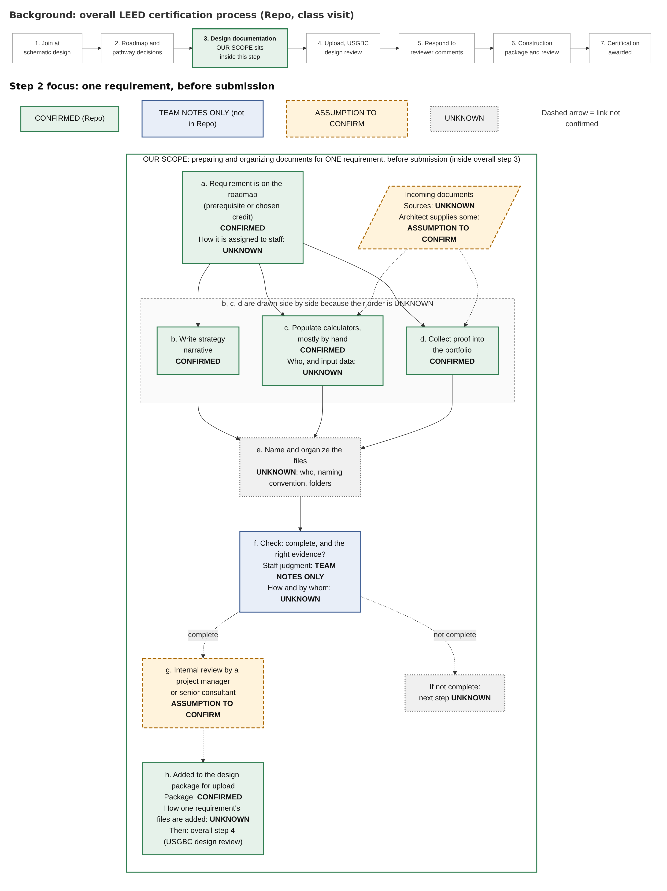

# Team Workflow Report: Preparing and Organizing Documents for One LEED Certification Requirement

**Course:** SE 395-2: AI Tools for Social Impact. **Lab 4: Team Deliverable**
**Partner:** ecoPreserve
**Team 3:** Jillian Shapiro, Madelyn Wiener, Xavier Davis, Ryan Conroy
**Draft date:** October 13, 2026

## How to read the labels in this report

| Label | What it means |
|---|---|
| **CONFIRMED** | Stated by Oscar in the September 10, 2026 class visit, or in the partner brief in our repo |
| **TEAM NOTES ONLY** | In our team's notes, but not found in the repo |
| **PROPOSED** | A design choice our team is suggesting. ecoPreserve does not do this today. |
| **ASSUMPTION TO CONFIRM** | Our guess. It still needs to be checked with ecoPreserve. |
| **UNKNOWN** | We don't have this information yet |
| **UNTESTED** | An idea about time or effort that nobody has measured |

**About our sources:** every confirmed fact in this report comes from Oscar's September 10 class visit (`partner-brief/class-visit-transcript.md`) and the partner brief. There are no partner-meeting notes in the repo yet. We have not reviewed a sample project, and we have not tested anything.

---

## Contents

1. [Original cold reality: how ecoPreserve does the workflow today](#part-1-original-cold-reality)
2. [Revised version after the swap test](#part-2-revised-version-after-the-swap-test)
3. [AI recipe](#part-3-ai-recipe)
4. [Proposal seed](#part-4-proposal-seed)
5. [Missing material](#missing-material-needed-to-complete-this-report)

---

## Part 1: Original Cold Reality

*Preserved as first written, before the swap test. The "Steps in order" section is also saved on its own as [step2-v1-original.md](step2-v1-original.md). The other sections are copied from the original description in Ryan's AI conversation log.*

**Source labels:** **[Repo]** = Oscar's September 10 class visit and the partner-brief summaries drawn from it. **[Team notes]** = our team's working notes. There are no partner-meeting notes in the repo. Nearly every team note matches the class-visit transcript; the ones that don't are marked "Team notes only."

**Framing:** the sources describe the process at the project level. Nothing describes how staff handle a single requirement, so most requirement-level detail is UNKNOWN until we review a sample.

### 1. Where the documents come from

| Document type | What we know | Who produces or supplies it | Source |
|---|---|---|---|
| Calculators | Populated "for the most part, manually" | **UNKNOWN**. Where the input data comes from is also **UNKNOWN**. | Repo; Team notes |
| Strategy narratives | ecoPreserve creates narratives "to describe the strategy that they want to use" | ecoPreserve ("we create") | Repo; Team notes |
| Proof of compliance | ecoPreserve pulls "a portfolio of proof that the building is compliant during the design phase" | Who first creates the proof documents is **UNKNOWN**. **ASSUMPTION TO CONFIRM:** the design team (for example, the architect) supplies some of it, since Oscar mentioned working with the architect on the Orange County Convention Center. | Repo; Team notes |
| Documentation supporting the client's decisions | "A lot of documentation that supports those decisions" | **UNKNOWN** | Repo |

- How documents reach ecoPreserve (email, portal, shared folder): **UNKNOWN**
- Where files are stored: **UNKNOWN**
- File formats: **UNKNOWN**

### 2. Steps in order

**Project-level process (confirmed)** [Repo; matches steps 1–6 of our notes]

1. **ecoPreserve gets involved at schematic design.** Our notes say "early design stage." Oscar said they help clients "from the very beginning where they're in conceptual design," but get involved once schematic design starts.
2. **ecoPreserve helps the client plan the path.** It helps the client understand what's required, creates a roadmap, and helps decide how to reach the target level: meeting the prerequisites plus choosing credits that add up to enough points.
3. **ecoPreserve documents during design.** It documents what the building needs to do and creates strategy narratives. Then it documents information and pulls together the portfolio of proof.
4. **The package goes to USGBC.** It is uploaded online and reviewed by USGBC's certifying agency.
5. **Reviewer comments come back.** Questions and comments return to ecoPreserve, and the team addresses them.
6. **The construction package is reviewed.** During construction, a package is put together again and sent for construction review.
7. **Certification is awarded.** Once the project passes construction review, ecoPreserve's job is done.

**One requirement, before submission (our scope, inside step 3)**

| Step | What happens | Status |
|---|---|---|
| a | The requirement is on the project roadmap, as a prerequisite or a chosen credit | Repo. How it is assigned to a staff member is **UNKNOWN**. |
| b | The strategy narrative is written | Repo |
| c | Calculators are populated, mostly by hand | Repo |
| d | Proof documents are collected into the portfolio | Repo |
| e | Files are named and organized | **UNKNOWN**: who does it, naming convention, folder structure |
| f | Documents are checked to see whether they are complete and provide the right evidence | Team notes only (that this takes judgment). How and by whom is **UNKNOWN**. |
| g | Internal review by a project manager or senior consultant | **ASSUMPTION TO CONFIRM** (Team notes) |
| h | The requirement's documents go into the design package for upload | Repo for the package. How one requirement's files get added is **UNKNOWN**. |

- **Order of steps b–d:** Oscar described narratives before proof, but only at the project level. Whether staff follow that order for each requirement, or do the steps in parallel, is **UNKNOWN**.
- **Steps e and f** are the core of our workflow, and they are the least documented.

### 3. Decisions requiring staff judgment

- **Which credits to pursue and how to reach the certification level.** Oscar said "we help them make those decisions," so the client decides with ecoPreserve's guidance. [Repo]
- **How to explain the project's strategy in the narrative.** The repo confirms ecoPreserve writes the narratives; our notes say this takes judgment. [Repo; Team notes]
- **Whether the documents provide the right evidence.** [Team notes only]
- **How staff decide a requirement's documents are complete:** **UNKNOWN**. No criteria are described anywhere.
- **How to respond to reviewer comments:** "we address them." This happens after submission, so it's outside our scope. [Repo]
- **Which staff role makes each of these calls:** **UNKNOWN**

### 4. Handoffs and review points

| Handoff or review | Status |
|---|---|
| ecoPreserve and the client make pathway decisions together | Repo |
| ecoPreserve works with the project's architect (Convention Center example) | Repo. Whether the architect hands documents to ecoPreserve for each requirement is an **ASSUMPTION TO CONFIRM**. |
| ecoPreserve works as a sub-consultant under a larger engineering or construction firm | Repo (business model). That firm's role in certification documents is **UNKNOWN**. |
| The person who gathers documents hands them to an internal reviewer | **ASSUMPTION TO CONFIRM** (Team notes). "Project manager" doesn't appear in the repo. Oscar mentions "the senior consultant on the project" in a different engagement; whether certification projects have a similar lead is an **ASSUMPTION TO CONFIRM**. |
| The package is uploaded and reviewed by USGBC's certifying agency | Repo. Who uploads it is **UNKNOWN**. |
| Reviewer comments return to ecoPreserve | Repo |
| The construction package goes to construction review | Repo |

### 5. Final output and who receives it

- **Confirmed, project level:** the design package, uploaded for USGBC review, and later the construction package. [Repo]
- **Single requirement:** what the finished set looks like and who receives it are both **UNKNOWN**.
- **Our proposed boundary:** an organized set of documents for one requirement, ready for internal review. [Team notes] This is our scope definition, not a confirmed current deliverable.
- **Proposed recipient:** a project manager or senior consultant. **ASSUMPTION TO CONFIRM** [Team notes]

### 6. Information we still need to confirm

1. Whether an internal review happens before upload, and who does it. **ASSUMPTION TO CONFIRM**
2. Which documents come from the client, the architect, the larger partner firm, or ecoPreserve. **UNKNOWN**
3. Where files are stored and in what formats. **UNKNOWN**
4. Who gathers, names, and organizes the files. **UNKNOWN**
5. Whether naming and folder structures differ across staff. **UNKNOWN**
6. How staff decide a requirement's documents are complete and sufficient. **UNKNOWN**
7. How many documents one requirement involves and how long the task takes. **UNKNOWN**
8. How a requirement is assigned to a staff member. **UNKNOWN**
9. Whether narratives, calculators, and proof are done in order or in parallel. **UNKNOWN**
10. Who populates the calculators and where their input data comes from. **UNKNOWN**
11. Who uploads the package. **UNKNOWN**
12. Whether the requirement-level steps differ between the design and construction packages. **UNKNOWN**
13. Whether ecoPreserve uses any software to manage these documents today. Oscar mentioned Green Badger but didn't say ecoPreserve uses it. **UNKNOWN**

**Access constraint:** client work is confidential and an NDA is required. [Repo: `constraints.md`; Team notes]

---

## Part 2: Revised Version After the Swap Test

*Full revised file: [step2-v2-revised.md](step2-v2-revised.md).*

### Swap-test feedback

**Actual feedback received:** "Wasn't represented by a clear diagram of the workflow."

### What the other team misunderstood

**No specific misunderstanding was recorded.** The feedback was about format (no diagram), not about any point of content the other team got wrong.

Separately, here is our own view of why v1 was hard to follow. This is our interpretation, not the other team's feedback:
- It put two levels of process back to back as ordered lists: the 7-step project process and the a–h requirement process.
- The fact that a–h sits inside project step 3 was only stated in a table heading.
- Confirmed and unconfirmed steps looked alike when skimmed.
- In a numbered list, unconfirmed links (f to g to h) looked as definite as confirmed ones.

### What we changed

- Added a workflow diagram (below).
- Cut the overall certification process to a short background strip, with step 3 highlighted as where our scope sits.
- Made the one-requirement steps (a–h) the main content.
- Showed each step's status in words inside every box, and also by color and border style.
- Drew unconfirmed links as dashed arrows.
- Drew steps b, c, and d side by side, with a note that their order is UNKNOWN.
- Ended the "not complete" path at UNKNOWN, instead of drawing a rework loop we can't confirm.
- Showed incoming documents as a separate input.
- Added a source column to the step table.
- **Added no new facts.**

**Scope of the revision:** only the "Steps in order" section was revised. Sections 1 and 3–6 of the cold reality were not rewritten; their open items are carried into the confirmation table at the end of this part.

### Revised workflow

**Background:** ecoPreserve gets involved at schematic design, then moves through design documentation, USGBC design review, construction review, and certification. **[CONFIRMED]** Our workflow is one small piece of **step 3, design documentation**.

| Step | What happens | Status | Source |
|---|---|---|---|
| a | The requirement is on the project roadmap, as a prerequisite or a chosen credit | **CONFIRMED**. How it is assigned to a staff member: **UNKNOWN** | Repo |
| Input | Documents come in from outside ecoPreserve | Sources: **UNKNOWN**. Architect supplies some: **ASSUMPTION TO CONFIRM** | Repo (architect example) |
| b | The strategy narrative is written | **CONFIRMED** | Repo |
| c | Calculators are populated, mostly by hand | **CONFIRMED**. Who populates them and where the input data comes from: **UNKNOWN** | Repo |
| d | Proof documents are collected into the portfolio | **CONFIRMED** | Repo |
| e | Files are named and organized | **UNKNOWN**: who does it, naming convention, folder structure | None |
| f | Documents are checked: are they complete, and do they provide the right evidence? | That this takes staff judgment: **TEAM NOTES ONLY**. How and by whom: **UNKNOWN**. What happens if documents are incomplete: **UNKNOWN** | Team notes |
| g | Internal review by a project manager or senior consultant | **ASSUMPTION TO CONFIRM**. The title "project manager" does not appear in the repo. | Team notes |
| h | The documents go into the design package for upload, followed by USGBC design review | Package: **CONFIRMED**. How one requirement's files are added: **UNKNOWN** | Repo |

### What still needs confirmation from ecoPreserve

| Diagram box | What to confirm | Status |
|---|---|---|
| g | Whether an internal review happens before upload, and who does it | ASSUMPTION TO CONFIRM |
| Input | Which documents come from the client, the architect, the larger partner firm, or ecoPreserve | UNKNOWN / ASSUMPTION TO CONFIRM |
| a | How a requirement is assigned to a staff member | UNKNOWN |
| b–d | Whether narrative, calculators, and proof are done in order or at the same time | UNKNOWN |
| c | Who populates the calculators, and where the input data comes from | UNKNOWN |
| e | Who gathers, names, and organizes files; where they are stored; what formats; whether naming and folders differ across staff | UNKNOWN |
| f | How staff decide documents are complete and sufficient, and who makes that call | UNKNOWN (that judgment is involved: TEAM NOTES ONLY) |
| f, not complete | What happens when documents are missing or insufficient | UNKNOWN |
| h | How one requirement's files are added to the package, and who uploads it | UNKNOWN |
| Whole workflow | How many documents one requirement involves, and how long it takes | UNKNOWN |
| Whole workflow | Whether these steps differ for the construction-phase package | UNKNOWN |
| Whole workflow | Whether any software is used to manage these documents today | UNKNOWN |

---

## Part 3: AI Recipe

*Full file: [step4-recipe-draft.md](step4-recipe-draft.md). This recipe is a proposal on paper. We have not chosen software, built anything, or tested anything.*

**Scope:** organizing the documents only, meaning naming them, putting them in the right folder, and spotting gaps or files that don't fit. Choosing credits, writing narratives, filling in calculators, and collecting proof stay exactly as they are today.

### 1. Ingredients

**Documents for one requirement**

| Ingredient | Quantity | Status |
|---|---|---|
| The requirement itself (a prerequisite or a chosen credit) | 1 | **CONFIRMED** that requirements come in these two types |
| Strategy narrative | **UNKNOWN** | **CONFIRMED** document type |
| Calculator(s), filled in mostly by hand | **UNKNOWN** | **CONFIRMED** document type |
| Proof-of-compliance documents | **UNKNOWN** | **CONFIRMED** document type. Where they come from: **UNKNOWN** |
| Other documentation supporting the client's decisions | **UNKNOWN** | **CONFIRMED** at the project level. Whether it applies to each requirement: **UNKNOWN** |
| File formats | **UNKNOWN** | **UNKNOWN** |
| Total number of files for one requirement | **UNKNOWN** | **UNKNOWN** |

**Rules and structure**

| Ingredient | What exists today | What we propose |
|---|---|---|
| **Requirement checklist** | **UNKNOWN** whether one exists | **PROPOSED:** a checklist written and approved by qualified ecoPreserve staff, not by AI. The AI may only sort files into categories on this list. |
| **Naming rule** | **UNKNOWN** whether one exists. Variation across staff: **ASSUMPTION TO CONFIRM** | **PROPOSED:** one written naming rule that ecoPreserve agrees on. Possible parts include project, requirement, document type, and version or date; the final rule is ecoPreserve's call. |
| **Folder structure** | **UNKNOWN**. Variation across staff: **ASSUMPTION TO CONFIRM** | **PROPOSED:** one folder template for each requirement, agreed with ecoPreserve |
| **Project AI status** | **CONFIRMED** that some government clients ban AI and require a signed form saying none was used | **PROPOSED:** a clear yes or no recorded for each project before the workflow starts |
| **An approved AI tool** | **CONFIRMED** that ecoPreserve uses Microsoft Copilot, Grammarly, and Google NotebookLM. Whether any is approved for confidential client files: **UNKNOWN** | **PROPOSED:** only a tool ecoPreserve has approved for confidential client documents. We are not picking one. |

**People**

| Role | Status |
|---|---|
| **Preparer** (gathers and organizes the files) | Who this is today: **UNKNOWN** |
| **Qualified reviewer** (decides whether the evidence is good enough) | Project manager or senior consultant: **ASSUMPTION TO CONFIRM**. ecoPreserve has 15 consultants, all senior (**CONFIRMED**). How many work on one requirement: **UNKNOWN** |

### 2. Method

Every step is **PROPOSED** unless marked otherwise.

| # | Who | What happens |
|---|---|---|
| 1 | **Human (preparer)** | **Check the project's AI status.** If AI is banned, or the status is unclear, skip steps 4–5 and do steps 6–10 by hand, using the same checklist, naming rule, and folders. If it's unclear, treat it as banned until someone confirms. |
| 2 | **Human (preparer)** | **Set up.** Confirm which requirement this is. Open its approved checklist, the naming rule, and the folder template. |
| 3 | **Human (preparer)** | **Gather the files into one working spot.** Narratives, calculators, and proof are made the same way as today. (**CONFIRMED** that these are prepared today. **UNKNOWN** who prepares them and where they're stored.) |
| 4 | **AI** | **Suggest, but don't change anything.** For each file, the AI suggests (a) a checklist category, (b) a filename that follows the naming rule, and (c) a folder location. It works only inside the approved tool. |
| 5 | **AI** | **Flag what it isn't sure about:** (a) files it can't confidently categorize, (b) likely duplicates or older versions, (c) files that may not belong to this requirement, and (d) checklist items with no matching file, labeled "possibly missing." **The flags are hints, not decisions.** |
| | **Handoff 1** | The AI gives the preparer a list of suggestions and flags. Nothing has been renamed or moved yet. |
| 6 | **Human (preparer)** | **REVIEW POINT 1: review every suggestion.** Accept, edit, or reject each one. Sort every flagged file by hand. |
| 7 | **Human (preparer)** | **Apply only approved changes.** Keep a record of the original filenames so any change can be undone. |
| 8 | **Human (preparer)** | **Organization check.** Make sure every file is in the right folder with the right name, and note which checklist items have no file. This checks organization only, not whether the evidence is good enough. |
| | **Handoff 2** | The preparer sends the organized set to the qualified reviewer. (Who receives it: **ASSUMPTION TO CONFIRM**) |
| 9 | **Human (qualified reviewer)** | **REVIEW POINT 2: evidence decision.** Decide whether the documents are accurate and sufficient evidence for the requirement. **AI plays no part in this decision.** If the answer is no, the set goes back to the preparer with what's needed (**PROPOSED**; what happens today is **UNKNOWN**). |
| 10 | **Human** | **Into the package.** The approved set goes into the design package for upload and USGBC review. (**CONFIRMED** that a design package is uploaded and reviewed. How one requirement's files are added and who uploads them: **UNKNOWN**) |

**Confidentiality rules (PROPOSED)**
- Client documents stay inside an approved tool and never go into a personal or unapproved AI tool.
- Projects that ban AI follow the manual path in step 1. Using AI on them would break the signed form (**CONFIRMED** that the form exists).
- Our team works only with approved or sanitized samples, under the NDA (**CONFIRMED** that an NDA is required).

### 3. Time and Serves

| Item | Answer |
|---|---|
| **Current time to organize one requirement's documents** | **UNKNOWN**. No source gives a time. |
| **Proposed time** | **UNKNOWN / UNTESTED**. We have no baseline, so we are not giving a number. |
| **What could add time** | **UNTESTED:** writing the checklist and naming rule once, checking every AI suggestion, and sorting flagged files by hand |
| **What could save time** | **UNTESTED:** fewer manual renames and moves, and gaps spotted earlier |
| **How we would find out** | **PROPOSED:** time the current process on one approved sample requirement, then time the proposed version on the same kind of requirement, *including* review time |
| **Serves** | 1 organized set of documents for 1 requirement |
| **Who receives it** | **ASSUMPTION TO CONFIRM:** a project manager or senior consultant. Whether this internal handoff happens today: **UNKNOWN** |
| **Where it goes after that** | **CONFIRMED:** into the design package for USGBC review |

### 4. Chef's Note

**The one responsibility AI must never take over:** deciding whether the documents are accurate and sufficient evidence that the building meets the certification requirement.

**Why it has to be a qualified human**
- **Organizing is not judging.** An AI can notice that a file *looks like* proof. It can't tell whether that proof actually shows this building meets this requirement, which takes knowledge of LEED and of the project.
- **It matches how ecoPreserve works.** Oscar said AI is "an enhancer, not a replacer," and the firm doesn't hand off recommendations "based on real experience" to AI. (**CONFIRMED**)
- **Someone has to be accountable.** ecoPreserve submits these packages for the client, and a person needs to stand behind that.

**What could go wrong if AI made this decision** (possible risks, not things that have happened)
- The wrong file is accepted: an old draft, the wrong version, or a file from a different building, approved because its name or format looked right.
- A missing or weak document is called "complete."
- Calculator mistakes slip through, because organizing a calculator file doesn't check its numbers.
- More reviewer pushback and delays. USGBC reviewers already send questions back (**CONFIRMED**); how much more rework weak evidence would cause is **UNKNOWN**.
- Damaged trust: a false claim of compliance could hurt the client's certification and ecoPreserve's reputation.

**AI also should not** choose credits, write the strategy narrative, or fill in calculators. Those stay with staff, as they are today.

---

## Part 4: Proposal Seed

### 1. The workflow we are targeting and why

We are targeting one narrow workflow: **preparing and organizing the documents for one LEED certification requirement on an ecoPreserve project**, before those documents go into the package submitted for USGBC review.

Why this workflow:
- **Oscar asked for it.** He listed green building certification documentation as one of three areas he wanted student help with, saying, "I feel that there is some repetition, some predictability that could be streamlined." He also said certifications follow "a very predictable process for the most part." (**CONFIRMED**)
- **It is a large share of the work.** Green building certification is about half of ecoPreserve's business. (**CONFIRMED**)
- **It is manual.** The work involves strategy narratives, calculators "populated, for the most part, manually," and a "portfolio of proof." (**CONFIRMED**)

We narrowed the scope to **one requirement** and to **organizing** the documents, not judging them. One requirement is a small enough unit to study on a single sample project. Keeping our scope to organizing also keeps professional judgment with ecoPreserve's consultants, which fits Oscar's view of AI as "an enhancer, not a replacer." (Scope choice: **PROPOSED**)

### 2. How ecoPreserve does it today

At the project level, the process is well described:
1. ecoPreserve joins at schematic design and builds a roadmap with the client.
2. It documents the building's strategy and pulls together proof.
3. A design package is uploaded for USGBC review.
4. Reviewer comments come back and are addressed.
5. A construction package is reviewed.
6. Certification is awarded. (**CONFIRMED**)

At the level of one requirement, we know much less. We know that:
- each requirement is either a prerequisite or a chosen credit,
- ecoPreserve writes the strategy narratives,
- calculators are filled in mostly by hand, and
- proof is collected into a portfolio. (**CONFIRMED**)

The part we want to improve is the least documented:
- **Naming and organizing the files:** UNKNOWN.
- **Checking whether the documents are complete and provide the right evidence:** TEAM NOTES ONLY. How and by whom is UNKNOWN.
- **An internal review before submission:** ASSUMPTION TO CONFIRM.

Everything confirmed comes from one source, Oscar's September 10 class visit. We have not reviewed a sample project.

### 3. Our recipe: how AI fits in

Our proposed recipe (**PROPOSED, UNTESTED**) gives AI a narrow job:
- For each file, it **suggests** a checklist category, a filename, and a folder location.
- It **flags** files it can't confidently categorize, likely duplicates or old versions, files that may not belong, and checklist items with no matching file.
- **It does not rename or move anything on its own.** A human reviews every suggestion, and only approved changes are applied. Original filenames are kept so changes can be undone.

The interview showed that this recipe has a requirement that comes before any AI step. **AI needs an approved checklist, naming rules, and a folder template before it can suggest how to organize files.** As Ryan put it, "If those don't exist, step 4 will not work as written. We would first need to work with ecoPreserve to create and approve a set checklist, naming rules, and folder template style." We don't know whether ecoPreserve has any of these today. Creating them would be a first step, and it is a **PROPOSED** step that ecoPreserve would need to agree to.

The recipe also has a manual path. On projects where a client bans AI, or where the AI status is unclear, the same steps are done entirely by hand.

We are not claiming any time savings. Both the current time and the proposed time are **UNKNOWN**.

### 4. What stays human and why

**Deciding whether the documents are accurate and sufficient evidence for the requirement stays with a qualified person.** AI plays no part in that decision.

Our first argument was that AI might "miss that context or treat an outdated document as valid." The interview showed that argument is weak on its own, because people make the same mistakes, and an argument based only on accuracy gets weaker as AI improves.

Our stronger argument is **accountability**. "A human should make the final decision because someone needs to take responsibility for it. If a problem comes up later, that person can share their reasoning, answer questions, as well as work with the client to fix it. AI can help with the review, but it can't take the responsibility for the outcome." A qualified person can also "ask the people involved to confirm missing or unclear information."

**What we haven't confirmed:** who holds this responsibility at ecoPreserve today. Our case for keeping the decision human depends on a role we haven't identified yet.

Choosing credits, writing narratives, and filling in calculators also stay with staff, as they are today.

### 5. The gaps we still need to fill

The individual AI interview showed several gaps. **We have not solved any of them.**

- **Basic facts about today's workflow are unconfirmed.** We still need to confirm:
  - **the starting point:** what starts the work for one requirement, and who starts it ("an inference based on Oscar's description");
  - **document suppliers:** who creates documents other than the narratives (ecoPreserve "could produce most of them itself");
  - **the output recipient:** what the output looks like and who receives it;
  - **the internal review:** whether it happens at all, since documents "could… go straight into the submission package."
- **The recipe depends on rules that may not exist.** AI needs an approved checklist, naming rules, and folder template before it can suggest how to organize anything.
- **Requiring human approval does not guarantee careful review.** "At the moment, nothing in our recipe ensures that someone checks every suggestion carefully. A busy consultant could approve the whole list and still miss errors." Files could then be "named or placed incorrectly, making important evidence harder to find." This risk is **unresolved**.
- **Checking AI permission at the start does not stop restricted documents from getting mixed in later.** "Checking permission at the start would not be enough if files from different projects get mixed together." A file from an AI-banned project reaching the AI tool "could go against the client's restrictions, expose confidential information, and hurt trust." We also don't know how staff check whether a project allows AI. This risk is **unresolved**.
- **The accountable person is unconfirmed.** A qualified person must remain accountable for deciding whether evidence is accurate and sufficient, but we have not confirmed who holds that responsibility.
- **There is no baseline data.** How many documents one requirement involves and how long organizing them takes are both **UNKNOWN**.

### 6. What we need from ecoPreserve to move forward

1. **A walkthrough.** A walkthrough of how one requirement's documents were prepared on a recent project, from start to submission (about 30 minutes with Oscar, or with a consultant he connects us to).
2. **A sample.** One completed requirement's documents, sanitized or shared under the NDA, so we can see real file types, quantities, and folder practices.
3. **Existing rules.** Whether a requirement checklist, naming rule, or folder template already exists, and if not, whether ecoPreserve would want to help create one.
4. **Who reviews and who is accountable.** Whether an internal review happens before upload, who does it, and who is responsible for the evidence decision.
5. **Document sources.** Which documents come from the client, the architect, the larger partner firm, or ecoPreserve itself.
6. **AI permissions.** How staff find out whether a project bans AI, and which AI tools, if any, are approved for confidential client files.
7. **A time baseline.** Roughly how long organizing one requirement's documents takes today, or permission to time it on a sample.
8. **How review works in practice.** How staff would realistically handle reviewing a list of AI suggestions, so the recipe matches how people actually work.

---

## Missing Material Needed to Complete This Report

| Missing item | Why it matters |
|---|---|
| **Partner-meeting notes.** None are in the repo; every confirmed fact comes from the September 10 class visit. | Most UNKNOWN and ASSUMPTION TO CONFIRM labels can't change until we hear from ecoPreserve directly. |
| **Swap-test details:** which team did the swap test, the date, and anything specific they got wrong when explaining it back. | The only recorded feedback is "Wasn't represented by a clear diagram of the workflow." If they misstated something specific, add it to Part 2. |
| **The full original cold reality as its own file.** `step2-v1-original.md` only preserves the "Steps in order" section. | Part 1 copies the other sections from Ryan's AI conversation log. A teammate should confirm this is the version the team submitted for Step 2. |
| **Other team members' individual AI interviews.** Only Ryan's interview summary was available. | Section 5 of the proposal seed reflects one interview. Other members' findings should be added if they exist. |
| **The team's reason for choosing this workflow over the other options.** | Xavier's opportunity analysis ranked editable executive summaries first and certification documentation second. The proposal seed gives Oscar's reasons for this area, but not the team's reason for choosing it over executive summaries. |
| **Authorship of each section.** | The course asks each student to own a labeled section of the final report. Contributions are not marked here. |
| **Merge to main.** These files are on the branch `ryan/current-workflow-step2`, not on `main`. | Teammates won't see them in the main folder until the branch is merged. |
